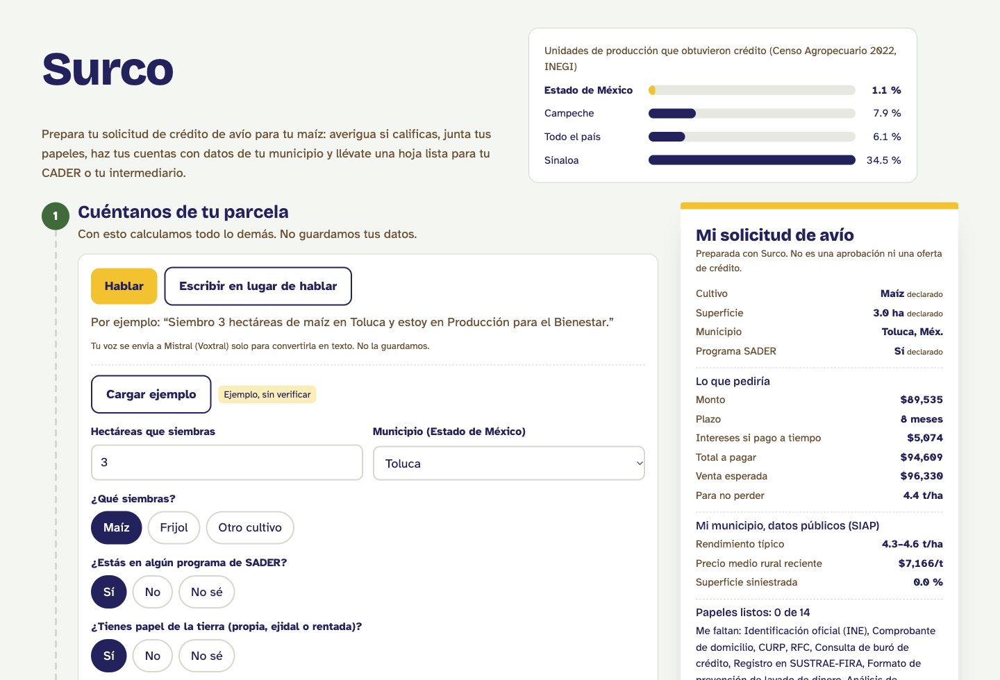
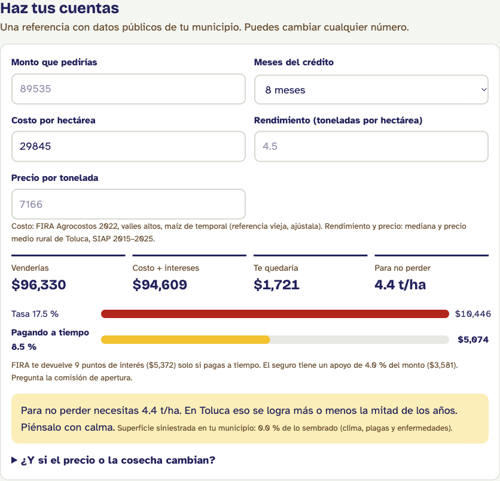
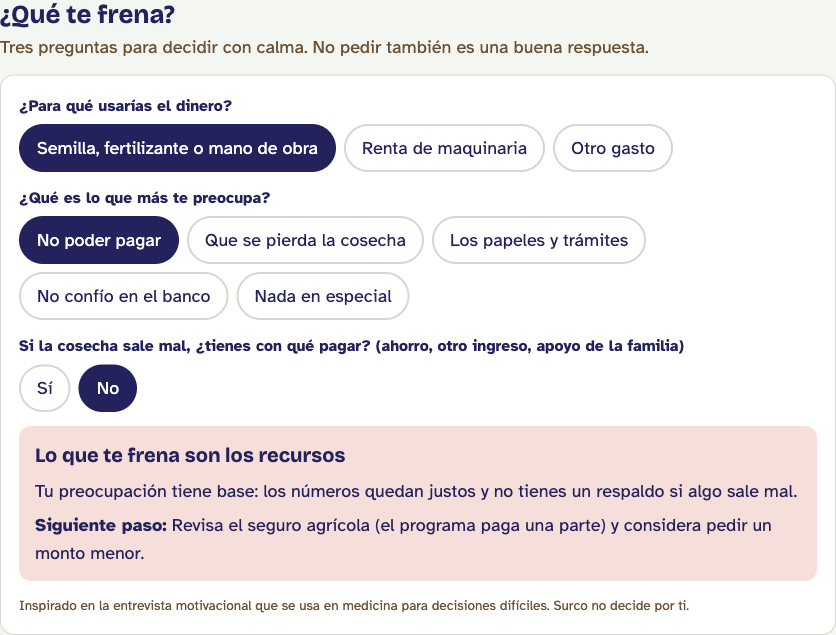

# Surco

**Prepara tu crédito de avío paso a paso, y decide con los números de tu municipio.**

Hackatón SECIHTI–CIDE con NVIDIA, CDMX, 29 de octubre de 2026. Track: Campo inteligente.

**Pruébalo:** https://surco-ivory.vercel.app (presiona "Cargar ejemplo" o usa el micrófono).



## Equipo

- Dr. Miguel Ojeda Rios, médico.
- Beatriz Hernández Alonso, maestra en Economía (UNAM).
- Jonathan Ávila Pineda, ingeniero industrial (ITESM).
- Gabriel Castillo Suárez, estudiante de Computación (UNAM).

## El problema

- Solo **6.1 %** de las unidades de producción agropecuaria obtuvo crédito en 2022, y **1.9 %** tuvo seguro. En el Estado de México, el crédito fue de **1.1 %**; en Sinaloa, **34.5 %** (INEGI, Censo Agropecuario 2022).
- Pocos piden, pero casi todos los que piden obtienen: en 2019, **9.4 %** de las unidades solicitó crédito y **8.4 %** lo obtuvo (INEGI, ENA 2019). La lectura de que cerca de 9 de cada 10 solicitantes lo consiguen es un cálculo nuestro con esas dos cifras.
- Quienes no piden dicen que es por intereses altos (64.3 %), muchos requisitos (49.6 %) y no querer endeudarse (45.4 %) (INEGI, ENA 2014; respuesta múltiple).

El cuello de botella no es el banco: es decidir y prepararse.

## Qué hace Surco

Acompaña a un pequeño productor (o al técnico que lo atiende) en seis pasos:

1. **Cuéntanos de tu parcela**, por voz o por escrito. Voxtral (Mistral) transcribe y Mistral Small extrae los datos; un normalizador valida lo dudoso.
2. **¿Calificas?** con las reglas publicadas de Cosechando Soberanía. Nunca dice "no": dice qué confirmar en la CADER y muestra otras rutas.
3. **Haz tus cuentas** con el costo de FIRA Agrocostos y el rendimiento y precio reales de su municipio (SIAP): costo con y sin bonificación, punto de equilibrio y alerta de riesgo.
4. **¿Qué te frena?**: un balance de decisión inspirado en la entrevista motivacional que distingue miedo, falta de recursos o riesgo real. No pedir también es una buena respuesta.
5. **Junta tus papeles** (solo si decide pedir), incluida la lista de lo que no le pueden exigir.
6. **Llévate tu hoja**: una página para la CADER o el intermediario, con los datos declarados marcados.

### El caso que muestra para qué sirve

Con 3 hectáreas de maíz en Toluca, la referencia de FIRA supone 7 t/ha, pero SIAP registra 4.3 a 4.6 t/ha en ese municipio. Con el rendimiento real, después de pagar el crédito le quedarían **$1,721**, y necesita cosechar **4.4 t/ha** para no perder. Surco lo muestra antes de que el productor firme.





**Lo que no hace:** no tramita créditos, no evalúa solvencia, no promete aprobación, no recomienda intermediarios y no guarda audio ni datos personales. Los cálculos los hace el código; la IA solo entiende la voz.

## Datos y trazabilidad

| Fuente | Uso | Estado |
|---|---|---|
| SIAP, Cierre de la producción agrícola, nivel municipal, CSV 2015–2025 ([datos abiertos](https://nube.agricultura.gob.mx/datosAbiertos/Agricola.php)) | Rendimiento, precio medio rural y superficie siniestrada de maíz grano por municipio del Estado de México | Verificado: descargado y procesado; 124 municipios |
| FIRA, Agrocostos (`agrocosto_data_completa.csv`, [portal](https://www.fira.gob.mx/Nd/Agrocostos.jsp)) | Costo por hectárea de referencia | Verificado: referencia de 2022, zona Valles Altos, maíz de temporal; FIRA advierte que viene de pocas observaciones |
| INEGI, Censo Agropecuario 2022 y ENA 2019 | Crédito y seguro; contexto | Verificado |
| INEGI, ENA 2014 | Motivos para no solicitar crédito | Reportado |
| FIRA, Lineamientos Cosechando Soberanía, edición 8 ([página](https://www.fira.gob.mx/Nd/fondoCosechandoSoberania.jsp)) | Requisitos, tasa de hasta 17.5 % con bonificación de 9 puntos, incentivo al seguro por segmento | Reportado: confirmar en el original |
| SADER, [Cosechando Soberanía](https://www.gob.mx/agricultura/acciones-y-programas/cosechando-soberania) | Cultivos elegibles y montos máximos | Verificado |

**Advertencias:** en SIAP, la columna de precio se llama `Precio` hasta 2020 y `Preciomediorural` desde 2021; los archivos de 2020 y 2021 tienen menos filas. SIAP mezcla productores de todos los tamaños y sus cifras son anuales y municipales. "Siniestrada" incluye clima, plagas y enfermedades. Los archivos originales van en `data/raw/` (fuera de git); `npm run data` regenera `data/*.json`.

## Impacto (escenario, no promesa)

Beneficio por productor que paga a tiempo = bonificación de 9 puntos de interés + apoyo al seguro. Ejemplo: $80,000 a 8 meses = $4,800 + $4,000 = **$8,800**. Cuántos productores piden después de usar Surco es un supuesto que se mide en un piloto con técnicos de la CADER, usando registros del intermediario.

## Cómo correrlo

```bash
npm install
# crear .env.local con MISTRAL_API_KEY=... (solo para la voz)
npm run build && npm run start -- -p 3210
npm test   # 20 pruebas
```

Sin clave de Mistral todo funciona excepto la voz; "Cargar ejemplo" funciona sin conexión.

## Estructura

- `components/` tablero y voz · `lib/` reglas del crédito, cuentas, expediente, balance de decisión, perfil y cliente de Mistral · `app/api/` rutas de transcripción y extracción · `data/` datos procesados · `scripts/` procesamiento de datos · `tests/` pruebas · `docs/` diseño, plan y flujo del equipo.

## Ruta de mejora

1. Piloto medido con técnicos de la CADER.
2. Entrevista motivacional conversacional (con experiencia clínica del equipo).
3. Asistente con citas, entrenado solo en documentos de FIRA y SADER.
4. Canal por WhatsApp; datos de Agrocostos 2024–2026; más cultivos y estados.

## Aviso

Surco orienta; no es una entidad financiera. Las reglas del programa pueden cambiar: confírmalas en tu CADER. Conflicto de interés: el equipo no vende servicios a través de Surco.
