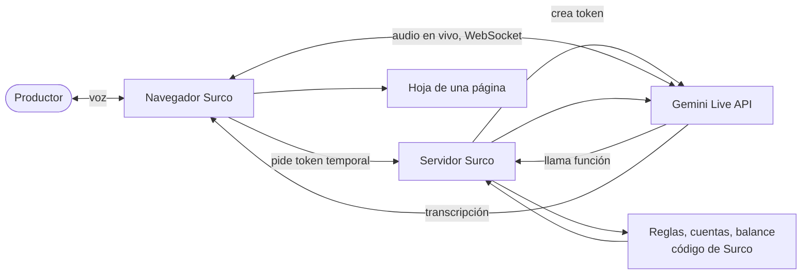

# Surco en vivo: agente de voz en tiempo real (siguiente versión)

**Estado:** propuesta para después del hackatón. No está en la demo del 29 de octubre de 2026.

## Para quién y por qué

El productor renuente no llena formularios ni sabe qué decir. Quienes no piden crédito citan intereses altos (64.3 %), muchos requisitos (49.6 %) y no querer endeudarse (45.4 %) (INEGI, ENA 2014). Una conversación de voz natural, que escucha y pregunta qué le preocupa, puede abrir esa puerta mejor que una pantalla.

## Qué haría

Un agente que conversa por voz con el productor, en español, al estilo de la entrevista motivacional:

1. Pregunta abierta: "¿Qué le gustaría lograr con su parcela este ciclo?"
2. Escucha y refleja lo que el productor dice, incluidas sus dudas.
3. Reúne los datos (cultivo, hectáreas, municipio, programa, papeles).
4. Llama a las reglas y a la calculadora de Surco para dar cifras reales; nunca las inventa.
5. Hace un balance de decisión: beneficios y riesgos de pedir y de no pedir.
6. Termina con una decisión informada: preparar la solicitud, pedir menos o no pedir.

**Regla ética central:** el agente no busca que el productor pida crédito. Su objetivo es que decida bien. "No pedir" es un resultado válido y se presenta sin presión.

## Tecnología: Gemini Live API (Google)

Revisado en la documentación de Google el 29 de octubre de 2026.

| Aspecto | Lo que ofrece |
|---|---|
| Conversación | Voz a voz con baja latencia; el usuario puede interrumpir al modelo en cualquier momento |
| Turnos | Detección automática de cuándo habla el usuario (sin botones) |
| Idioma | Español; los modelos de audio nativo eligen el idioma solos |
| Herramientas | Llamadas a funciones: el agente puede usar las reglas y la calculadora de Surco |
| Transcripción | Texto de lo que dicen el usuario y el modelo, para la hoja y para revisión |
| Modelos | `gemini-3.8-live` (recomendado, disponible de forma general). En ese modelo se quitó el "diálogo afectivo"; sigue en `gemini-live-2.5-flash-native-audio` (Google Cloud) |
| Conexión | WebSocket con estado; audio PCM de 16 kHz de entrada y 24 kHz de salida |
| Seguridad | Desde el navegador se usan tokens temporales que genera el servidor; la clave nunca llega al cliente |
| Costo | Se cobra por audio (unos 25 tokens por segundo). En `gemini-3.8-live` el audio proactivo está siempre activo y se cobra mientras escucha. Precio exacto por confirmar |

Fuentes: [Gemini Live API](https://ai.google.dev/gemini-api/docs/live-api), [capacidades](https://ai.google.dev/gemini-api/docs/live-api/capabilities), [Gemini 3.8 Live](https://ai.google.dev/gemini-api/docs/models/gemini-3.8-live), [buenas prácticas y costos](https://ai.google.dev/gemini-api/docs/live-api/best-practices), [tokens temporales](https://ai.google.dev/gemini-api/docs/ephemeral-tokens).

## Evidencia sobre entrevista motivacional con IA

- Un agente de IA produjo conversaciones consistentes con la teoría de la entrevista motivacional; más "lenguaje de cambio" se asoció con más disposición a cambiar (Suffoletto et al., 2026, piloto en urgencias, [PubMed 42285418](https://pubmed.ncbi.nlm.nih.gov/42285418)).
- En un ensayo aleatorizado (N = 237), un chatbot motivacional aumentó la motivación a corto plazo, pero el efecto no duró 24 horas ni cambió la conducta (Eiroa-Solans e Inzlicht, 2026, [Computers in Human Behavior Reports](https://www.sciencedirect.com/science/article/pii/S2451958825002970)).
- Revisión de alcance: 12 de 15 sistemas mejoraron motivación o disposición, pocos midieron conducta real (Karve et al., 2025, [PMC12485255](https://pmc.ncbi.nlm.nih.gov/articles/PMC12485255/)).

**Lectura:** sirve para abrir la conversación con alguien renuente; no debe prometerse que cambie decisiones.

## Riesgos y cómo se manejan

| Riesgo | Manejo |
|---|---|
| Empujar a endeudarse | Objetivo de balance de decisión; "no pedir" como resultado válido; revisión del guion por personal clínico |
| Inventar reglas o cifras | Las reglas y las cuentas solo salen de funciones de Surco; el modelo no calcula |
| Internet rural inestable | Conservar la versión actual (pregunta por pregunta), que tolera mala señal |
| Privacidad del audio | Consentimiento explícito antes de empezar; no guardar audio; aviso de que va a Google |
| Usuarios mayores | Voz pausada, preguntas cortas, opción de pasar a un técnico de la CADER |
| Costo por minuto | Sesiones cortas, compresión de contexto y límite de duración |

## Arquitectura propuesta

## Plan de construcción (estimado: 1.5 a 2 horas)

1. Ruta de servidor que crea tokens temporales.
2. Captura de micrófono a PCM de 16 kHz y reproducción de audio de 24 kHz en el navegador.
3. Declarar como funciones: `evaluarElegibilidad`, `calcularCredito`, `resultadoCuentas`, `balanceDecision`.
4. Instrucciones del agente: entrevista motivacional (preguntas abiertas, afirmaciones, reflejos, resúmenes) con la regla ética central.
5. Prueba con 5 conversaciones grabadas y revisión humana del guion.

**Requisito:** una clave de la API de Gemini (Google AI Studio), guardada solo como variable del servidor.

## Cómo se mediría

Piloto con técnicos de la CADER: comparar la versión actual con la de voz en vivo en solicitudes completas presentadas, decisiones de "no pedir" informadas y satisfacción del productor.
